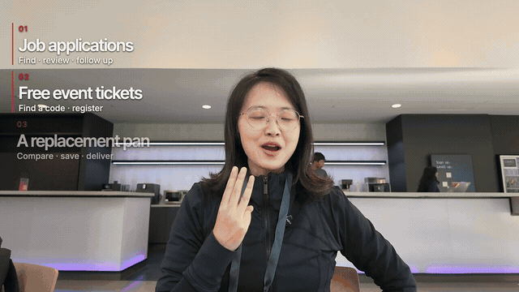
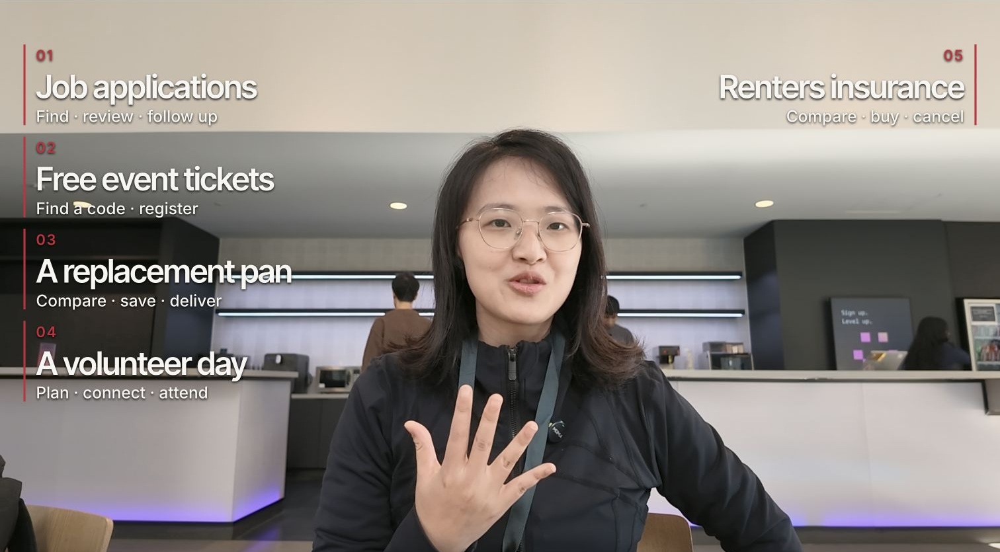

# Koki Long Video Skill

[](README.md) [](README.zh-CN.md) [](README.ja.md)

構成が明確で、実演が見やすく、映像・音声・字幕の各レイヤーが同期したチュートリアル動画とインタビュー動画を作るためのスキルです。

私自身のクリエイター向けワークフローを切り出し、カスタマイズ可能な公開版としてまとめた単独のスキルです。本READMEは日本語で読めます。スキル本体の手順とワークフロー資料は英語と簡体字中国語で提供しています。

## 完成イメージ

**事例、実演、字幕、解説が積み重なっても、長尺動画はずっと分かりやすく保てます。** 下の8秒の無音クリップは、私のClaudeチュートリアル英語版の実際の抜粋です。話し手が演奏を続けながら、話している内容に合わせて事例のラベルが表示されます。クリップ内の事例ラベルは英語で、中国語字幕はありません。



下の完成画面では、話し手のスペースを確保しながら、複数のユースケースを周囲に整理しています。



| 用意するもの | 得られるもの |
| --- | --- |
| チュートリアル素材、またはインタビューの録画 | 追跡可能な文字起こしとコンテンツ構成 |
| 実演、スクリーンショット、編集メモ | 発話に対応した、読みやすいビジュアル |
| 完成した編集 | カバー、タイトル、番組ノート、必要に応じてチャプターのタイムスタンプ |

発話を編集したら、それに連動する字幕、スクリーンショット、オーバーレイ、チャプターも一緒に同期させます。ここで紹介しているチュートリアルは実際のプロジェクトです。[素材の詳細](docs/media/README.md)。

## クイックスタート

### 1. エディタを接続する

Codex、またはChatCutに接続できる互換エージェントを使います。新規セットアップの場合は、[ChatCut公式のインストールガイド](https://chatcut.io/docs/agent-plugin)に従ってください。デスクトップ版エージェントでは、次のように送れます。

```text
Read ChatCut.io/desktop to install ChatCut
```

ChatCut内でサインインし、エージェントで新しいチャットを開始します。接続を確認するために、ChatCutのプロジェクト一覧を表示するよう依頼してください。ホスト型のWebプロジェクトが既にある場合は、[Web接続ガイド](https://chatcut.io/docs/web-plugin)を使います。

### 2. このスキルをインストールする

Codexに次を貼り付けます。

```text
$skill-installer 次の場所からスキルをインストールしてください：
https://github.com/kokiainet/koki-long-video-skill/tree/main/skills/long-video-editing
同名のスキルが既にある場合は保持し、上書きする前に競合を報告してください。
```

インストール後に新しいチャットを開始し、`$long-video-editing` で呼び出します。他のAgent Skills互換ツールでも、完全な `skills/long-video-editing` フォルダを各自の方法でインストールできます。[Codexのスキルドキュメント](https://learn.chatgpt.com/docs/build-skills)も参照してください。

### 3. 素材とゴールを渡す

映像素材／プロジェクト、チュートリアルかインタビューかの形式、参考台本、スクリーンショット／実演、正確に表記すべき名前や用語、想定する言語を渡します。まず文字起こし全文が欲しいのか、編集の完成まで任せるのか、完成済みの編集に対する公開用素材だけが欲しいのかも伝えてください。

### 4. 最初のプロンプトを選ぶ

**チュートリアル／複数のユースケース：**

```text
ChatCutと一緒に $long-video-editing を使ってください。
素材：./input/tutorial/
英語の16:9ソフトウェアチュートリアルです。実際のユースケースごとに構成してください。
実演とスクリーンショットには ./media/ を使い、UIが読みやすい状態を保ってください。
チャプタータイトルと字幕は英語で、発話の手順に合わせてください。スクリーンショットが
メイン画面になるときは、必要に応じて話し手の小窓を遮られない位置に置いてください。
編集可能なプロジェクトとして保存し、結果を見せてください。
```

**インタビュー、まず文字起こし：**

```text
$long-video-editing を使ってください。./input/interview.mp4 を読み取ってください。
まず話者と元のタイムコード付きで文字起こし全文を納品し、
次にチャプター構成を提案してください。全文は私が確認できるよう残してください。
編集は、私が最終台本を確定してから行ってください。
```

### 5. 修正と公開用素材を同期させる

```text
この回答を第2チャプターの前に移動してください。意味と話し手は変えずに、
影響を受ける字幕、画像、話者ラベル、チャプターを同期してください。
```

```text
最新の完成版をもとに、カバー、正式タイトル、番組ノート、
コピーできるチャプターのタイムスタンプを用意してください。各トピックが完成版と合っているか確認してください。
```

| 依頼する段階 | 納品物 |
| --- | --- |
| 文字起こし／構成 | 全文、話者、元の位置アンカー、提案する順序 |
| 編集 | 映像・音声レイヤーが同期した編集可能なプロジェクト |
| 公開用素材 | カバー、タイトル、番組ノート、完成版に合わせたチャプター時刻 |
| 書き出し | 依頼に応じてMP4／字幕ファイル |

プロジェクトはChatCutで開いて手動調整することも、自然言語で修正を続けることもできます。現在の版が完成したら、書き出しを明示的に依頼してください。

## 自分仕様にする

[creator.example.yaml](creator.example.yaml) を作業プロジェクト内に `creator.local.yaml` としてコピーし、名前、メディアのフォルダ、好みを記入します。エージェントはこのファイルを読みますが、アカウントに接続したり自動で実行したりはしません。私物のメディアや締めの文言が不足している場合は、元の作者のものを借用せず、スキップするか報告します。[PRIVACY.md](PRIVACY.md)も参照してください。

## ツール

これらのワークフローは主に [ChatCut](https://chatcut.io/docs/web-plugin) を使います。まず自分のエージェント環境で公式エディタツールを接続してください。このリポジトリは私個人のカスタムワークフローであり、ChatCut公式プラグインや同梱スキルではありません。デフォルトでは編集可能なプロジェクトとして保存し、書き出しや公開は依頼に応じて行います。外部サービスにはそれぞれの料金と規約があります。

## Kokiについて・連絡先

作成：**Koki**（Anti-Distill Skillの作者、Social Codingの提唱者）。

[Website](https://kokiai.net/) · [X / Twitter](https://x.com/kokiainet) · [Instagram](https://www.instagram.com/kokiainet/) · [YouTube](https://www.youtube.com/@kokiainet) · [LinkedIn](https://www.linkedin.com/in/koki-x-309815217/) · [Substack](https://kokimemo.substack.com/)

コラボレーションや質問は [X](https://x.com/kokiainet) か [LinkedIn](https://www.linkedin.com/in/koki-x-309815217/) でメッセージをください。スキルの不具合や提案は、このリポジトリのIssueでお願いします。私物のメディアやアカウント情報は公開Issueに書かないでください。

## 他のクリエイター向けスキル

- [Koki Writing Skill](https://github.com/kokiainet/koki-writing-skill)
- [Koki Short Video Skill](https://github.com/kokiainet/koki-short-video-skill)

## ライセンス

オリジナルのスキル手順とアダプタコードは [MIT](LICENSE) ライセンスです。サードパーティの製品、フォント、メディア、サービスには、それぞれのライセンスと規約が適用されます。

デモメディアはワークフローの紹介用に含まれています。映像素材、肖像、サードパーティ抜粋の権利は各権利者に帰属し、MITのコードライセンスでは許諾されません。[素材の詳細](docs/media/README.md)を参照してください。
