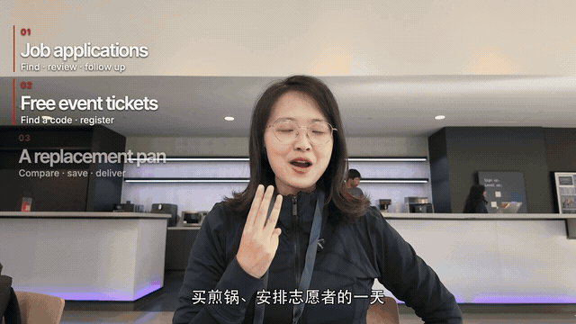
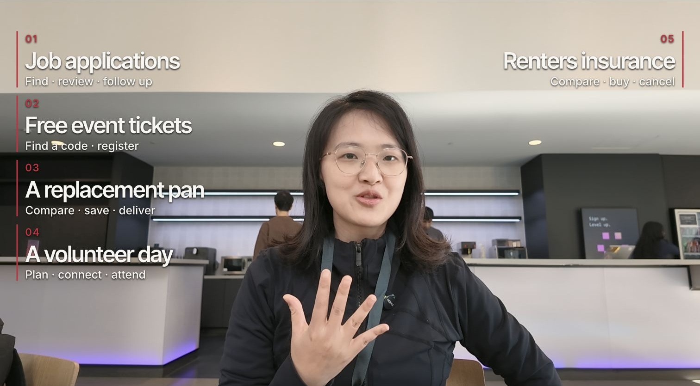

# Koki Long Video Skill

[](README.md) [](README.zh-CN.md)

Build tutorials and interviews with clear structure, readable demonstrations, synchronized layers, covers, and show notes.

A standalone skill from my own creator workflow, shared as a configurable public edition. Instructions and workflow references are available in English and Simplified Chinese.

## See the result

**A long video can stay clear as cases, demonstrations, captions, and explanations build up.** This eight-second silent excerpt is from my Muse tutorial: the case labels appear with the spoken introduction while the speaker continues playing.



The finished composition below gives the speaker room while organizing several use cases around her:



| You provide | You get |
| --- | --- |
| Tutorial footage or an interview recording | A traceable transcript and content structure |
| Demonstrations, screenshots, and edit notes | Readable visuals aligned to the corresponding speech |
| A finalized edit | Covers, title, show notes, and chapter timestamps when requested |

After a speech edit, keep dependent captions, screenshots, overlays, and chapters aligned. The tutorial shown here is a real project; [media details](docs/media/README.md).

## Quick start

### 1. Connect the editor

Use Codex or a compatible agent with ChatCut connected. For a new setup, follow [ChatCut's official installation guide](https://chatcut.io/docs/agent-plugin). In the desktop agent you can send:

```text
Read ChatCut.io/desktop to install ChatCut
```

Sign in inside ChatCut, then start a new agent chat. Ask it to list your ChatCut projects to verify the connection. For an existing hosted Web project, use the [Web connection guide](https://chatcut.io/docs/web-plugin).

### 2. Install this skill

Paste the following into Codex:

```text
$skill-installer Install the skill from
https://github.com/leilei926524-tech/koki-long-video-skill/tree/main/skills/long-video-editing
Keep an existing skill with the same name and report a conflict before replacing it.
```

Start a new chat after installation, then invoke `$long-video-editing`. Other Agent Skills-compatible tools can use the same complete `skills/long-video-editing` folder through their own installation method. See [Codex skills documentation](https://learn.chatgpt.com/docs/build-skills).

### 3. Provide the material and goal

Supply the footage/project, tutorial or interview format, reference script, screenshots/demos, required names/terms, and intended language. Tell the agent whether you want the full transcript first, a complete edit, or only publishing materials for an existing final cut.

### 4. Choose a starting prompt

**Tutorial / several use cases:**

```text
Use $long-video-editing with ChatCut.
Source footage: ./input/tutorial/
This is a 16:9 software tutorial. Organize it by the actual use cases.
Use ./media/ for demonstrations and screenshots; keep the UI readable.
Align chapter titles and captions to the spoken steps. When a screenshot
takes the main frame, use an unobstructed speaker inset where appropriate.
Save an editable project and show the result.
```

**Interview, transcript first:**

```text
Use $long-video-editing. Read ./input/interview.mp4.
First deliver the complete transcript with speakers and source timecodes,
then suggest a chapter structure. Keep the full content for me to review.
Wait for my final script before editing the video.
```

### 5. Keep revisions and publishing materials synchronized

```text
Move this answer before chapter two. Keep the meaning and speaker unchanged,
then synchronize the affected captions, images, identity labels, and chapters.
```

```text
Use the latest final cut to prepare the cover, formal title, show notes,
and copyable chapter timestamps. Verify each topic entry against the cut.
```

| Requested stage | Deliverable |
| --- | --- |
| Transcript / structure | Full text, speakers, source anchors, proposed order |
| Editing | Editable project with synchronized audiovisual layers |
| Publishing materials | Covers, title, show notes, final-cut chapter times |
| Export | MP4/subtitle files when requested |

Open the project in ChatCut for manual adjustments or continue with natural-language revisions. Ask explicitly for export when the current version is ready.

## Make it yours

Copy [creator.example.yaml](creator.example.yaml) to `creator.local.yaml` in your working project and fill in your name, media directories, and preferences. The agent reads this file; it does not connect accounts or execute by itself. Missing private media or closing text should be skipped or reported, never borrowed from the original author. See [PRIVACY.md](PRIVACY.md).

## Tools

These workflows primarily use [ChatCut](https://chatcut.io/docs/web-plugin). Connect the official editor tools in your agent environment first. This repository contains my custom workflow, not the official ChatCut plugin or its bundled skills. Save an editable project by default; export or publish when requested. External services may have their own fees and terms.

## About Koki & contact

Created by **Koki**, creator of Anti-Distill Skill and initiator of Social Coding.

[Website](https://kokiai.net/) · [X / Twitter](https://x.com/kokisanai) · [Instagram](https://www.instagram.com/kokisanai/) · [YouTube](https://www.youtube.com/@kokiainet) · [LinkedIn](https://www.linkedin.com/in/koki-x-309815217/) · [Substack](https://kokimemo.substack.com/)

For collaborations or questions, message me on [X](https://x.com/kokisanai) or [LinkedIn](https://www.linkedin.com/in/koki-x-309815217/). For a skill bug or suggestion, open an issue in this repository. Please keep private media and account details out of public issues.

## Other creator skills

- [Koki Writing Skill](https://github.com/leilei926524-tech/koki-writing-skill)
- [Koki Short Video Skill](https://github.com/leilei926524-tech/koki-short-video-skill)

## License

Original skill instructions and adapter code are licensed under [MIT](LICENSE). Third-party products, fonts, media, and services retain their own licenses and terms.

Demo media are included for showcasing the workflow; rights in the footage, likenesses, and third-party excerpts remain with their respective owners and are not granted by the MIT code license. See [media details](docs/media/README.md).
