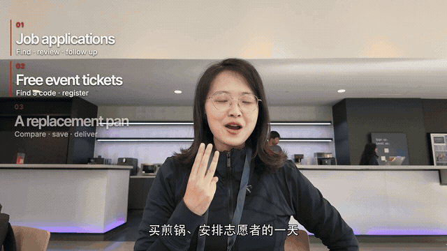
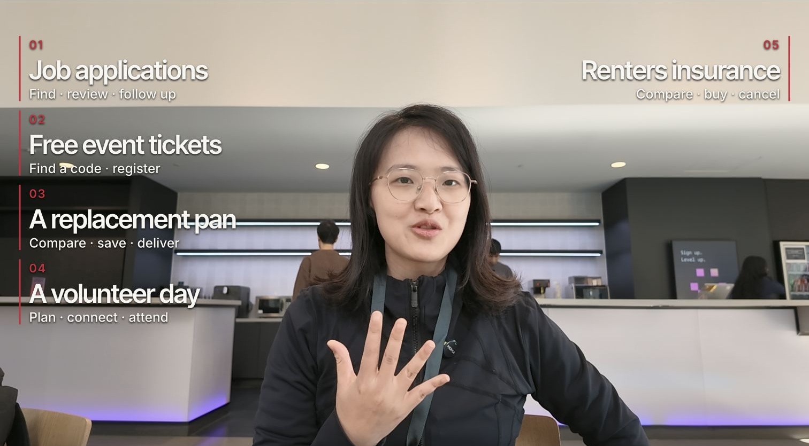

# 长视频创作 Skill

[](README.md) [](README.zh-CN.md) [](README.ja.md)

制作教程与访谈长视频：整理文稿与结构，配清楚的截图，联动字幕、章节、封面和 shownote。

这是从我的日常创作流程整理出的独立 Skill，公开版已做脱敏并支持自定义。技能说明与流程参考提供英文和简体中文版本，本介绍另有[日语版](README.ja.md)。

## 先看实际效果

**长视频里，案例、操作、字幕和解释都得让观众跟得上。** 下面这段八秒无声预览来自我的 Muse 教程：口播说到哪个案例，对应的文字就出现，人物画面始终正常播放。



完整构图里，人物与多个案例各自有空间，观众能看清这一期会讲什么：



| 你交给它 | 它帮你完成 |
| --- | --- |
| 教程原片或访谈录音录像 | 可追溯的完整文稿和内容结构 |
| 演示、截图与修改意见 | 与对应口播同步、看得清楚的画面 |
| 已定稿的剪辑 | 按需制作封面、正式标题、shownote 和章节时间码 |

口播插句、删句、调序之后，字幕、截图、花字和章节也要一起同步。这里展示的是我的真实教程项目。[素材说明](docs/media/README.md)。

## 从安装到第一次出结果

### 1. 先接上剪辑工具

使用 Codex 或兼容 Agent，并连接 ChatCut。新安装按 [ChatCut 官方指南](https://chatcut.io/docs/agent-plugin)操作，可以在电脑上的 Agent 对话里发送：

```text
Read ChatCut.io/desktop to install ChatCut
```

在 ChatCut 中登录，再开一个新的 Agent 对话。让它「列出我的 ChatCut 项目」，确认工具已连接。继续编辑已有 Web 项目时，按 [Web 连接指南](https://chatcut.io/docs/web-plugin)操作。

### 2. 安装这个 Skill

在 Codex 里直接粘贴：

```text
$skill-installer 安装这个地址里的技能：
https://github.com/kokiainet/koki-long-video-skill/tree/main/skills/long-video-editing
如果已有同名 Skill，先保留并说明冲突，不要直接覆盖。
```

安装后开一个新对话，再用 `$long-video-editing` 调用。其他支持 Agent Skills 的工具，可按自己的安装方式导入完整的 `skills/long-video-editing` 文件夹。也可查看 [Codex 官方技能文档](https://learn.chatgpt.com/docs/build-skills)。

### 3. 提供素材与本轮目标

交给它原片或已有项目，说明是教程还是访谈，附上文稿、截图或演示素材、必须写对的名字和术语、目标语言。说清这一轮要先拿完整文稿、直接剪片，还是只做已有成片的封面与发布文案。

### 4. 选一条指令开始

**教程／多个案例：**

```text
用 $long-video-editing，通过 ChatCut 制作。
原片：./input/tutorial/
这是 16:9 软件教程，按实际案例组织内容。
演示和截图在 ./media/，保证关键操作和文字看得清。
章节标题与字幕对应实际口播步骤。截图作主画面时，视情况放人物小窗，避开关键信息。
保存可编辑项目，给我看结果。
```

**访谈，先拿完整文稿：**

```text
用 $long-video-editing，读取 ./input/interview.mp4。
先交完整转写，区分说话人、保留原片时间码，再建议章节结构。
保留完整内容让我调整，等我确定文稿后再剪视频。
```

### 5. 改片与发布素材一起同步

```text
把这段回答移到第二章前面，保留原意与说话人，
同步受影响的字幕、图片、人物介绍和章节导航。
```

```text
按最新成片制作封面、正式标题、shownote 和可复制的章节时间轴。
每个话题入口都要回查成片，不能用原片时间码。
```

| 这轮要做什么 | 最后拿到什么 |
| --- | --- |
| 文稿／结构 | 完整文稿、说话人、原片位置与结构建议 |
| 剪辑 | 各层同步、可继续修改的项目 |
| 发布素材 | 封面、正式标题、shownote、成片章节时间码 |
| 按需导出 | MP4、字幕等文件 |

打开 ChatCut 可以继续手动调整，也能用自然语言继续改。当前版本确认可用后，再明确要求导出。

## 改成自己的风格

将 [creator.example.yaml](creator.example.yaml) 复制为当前项目中的 `creator.local.yaml`，填写自己的称呼、素材目录与偏好。配置供 Agent 读取，不会自行执行或连接账号。未提供的私人素材、结尾图片和 CTA 应跳过或说明，不寻找原作者的素材。隐私处理见 [PRIVACY.md](PRIVACY.md)。

## 工具

主要配合 [ChatCut](https://chatcut.io/docs/web-plugin) 使用，请先在 Agent 环境中连接官方编辑器工具。这里开源的是我的自定义流程，不包含 ChatCut 官方插件及内置技能。默认保存可编辑项目，按明确请求导出或发布；外部服务费用与条款由提供方决定。

## 关于作者与联系

作者：**邓小闲 Koki**，反蒸馏 Skill 作者、社会派编程发起人。

[中文个人网站](https://kokiai.net/zh) · [小红书](https://www.xiaohongshu.com/user/profile/5bfe825044363b01b593585e) · [B站](https://space.bilibili.com/438427470) · [抖音](https://www.douyin.com/user/MS4wLjABAAAAjxdS9GqgpuMLfZGvkM-Kctt6XSkvcr03ouQQv9oNlXHNIC64F4TjKr0cp-dkZcMK)

交流或合作请通过[小红书私信](https://www.xiaohongshu.com/user/profile/5bfe825044363b01b593585e)联系我。技能问题与建议可在本仓库提 issue；请勿在公开 issue 中上传私人素材和账号信息。

## 其他创作 Skill

- [文字创作 Skill](https://github.com/kokiainet/koki-writing-skill)
- [短视频创作 Skill](https://github.com/kokiainet/koki-short-video-skill)

## 开源许可

原创技能说明与适配代码采用 [MIT](LICENSE) 许可。第三方产品、字体、媒体与服务保留各自许可和条款。

演示图片与片段用于展示工作流；原片、人物形象及第三方摘录的权利归相应权利人，不随技能代码授予 MIT 许可。详见[素材说明](docs/media/README.md)。
